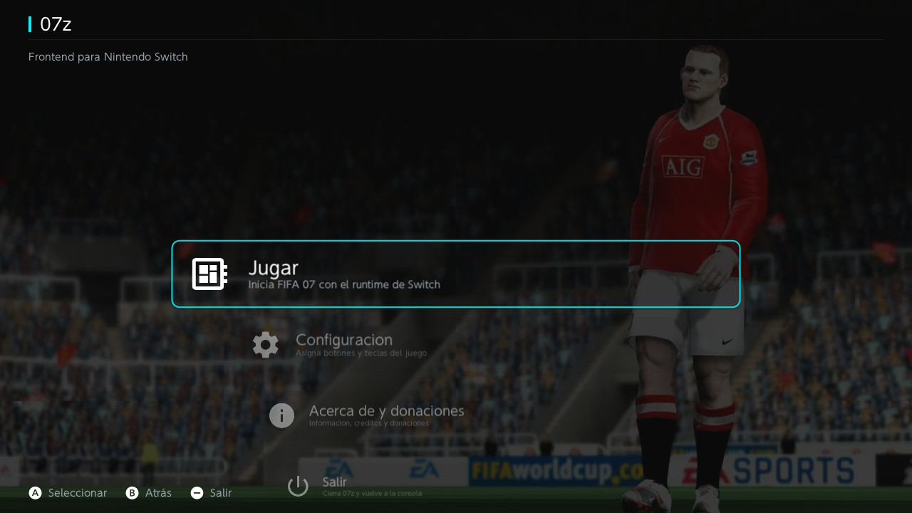
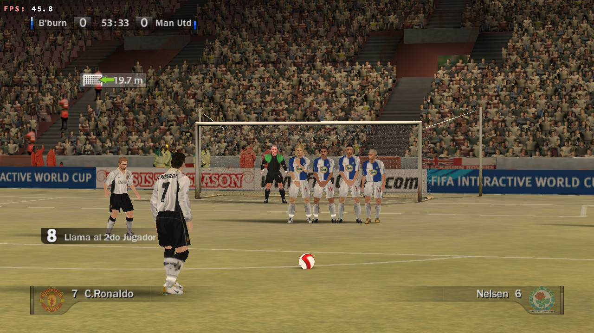
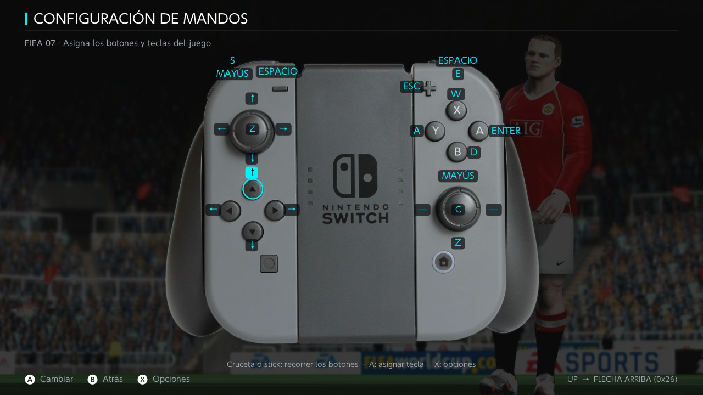

<h1 align="center">
    
</h1>

<h3 align="center">⚽ Juega a tu <b>FIFA 07</b> de PC en Nintendo Switch, como un juego más 🎮</h3>

<div align="center">


</div>

<hr/>

## 🌟 Qué es 07z

**Icono propio en el HOME, interfaz a medida y el partido arranca directo. Wine no se ve nunca.**
Usas **tu propia copia** de FIFA 07 de PC; 07z pone todo lo demás (frontend, instalador y runtime).

> ⚠️ Proyecto **personal y no oficial**, sin relación con EA. **Aquí no se distribuye el juego**:
> solo el envoltorio. «FIFA» se usa de forma descriptiva para indicar con qué juego es compatible.

|  |  |  |
|---|---|---|
| El menú de 07z | Un partido | Los mandos, desde la consola |

<hr/>

## 📥 Descargar

**[⬇️ Releases](../../releases/latest)** — necesitas **3 ficheros**:

- **`07z-base-interfaz.zip`** → copia su carpeta `switch/`
- **`parche-firmware-22.5.zip`** o **`parche-firmware-23.0.zip`** → **el de TU firmware**
- **`07z-instalador.nsp`** → el que se instala

_(¿Prefieres un solo archivo? `07z-completo.zip` los trae todos dentro.)_

## 🔧 Instalar (3 pasos)

**1.** Copia la carpeta **`switch/`** a la raíz de tu SD.

**2.** Copia la carpeta del parche que corresponda a **TU firmware** a la raíz de la SD:
`parche-de-tu-firmware/firmware-22.5/` si tienes el 22.5, o `firmware-23.0/` si tienes el 23.0
(lo ves en `Ajustes` → `Sistema` → `Versión`). Respeta lo que trae dentro (`atmosphere/…`).
_¿Lo olvidas? Pulsas Jugar y vuelves al menú: es exactamente eso._

**3.** Instala **`07z-instalador.nsp`** con tu instalador de siempre (Sphaira, DBI, Goldleaf…).

Y **tu juego** va aquí:

```
sdmc:/
└── switch/
    └── fifa07/                  <- los ficheros del PUESTO (del fichero 1)
        ├── 07z.nro
        ├── wine-nx-runtime.nro
        └── drive_c/
            └── FIFA 07/         <- TU INSTALACIÓN de FIFA 07 (fifa07.exe + sus datos)
```

> ⚠️ **No** crees una carpeta «FIFA 07» suelta en la raíz. El **port** va en `switch/fifa07/`
> y **tu juego** en `switch/fifa07/drive_c/FIFA 07/`. No copies `bootloader/` ni `emuMMC/`:
> eso es de la consola, no de 07z.

**Para jugar, abre 07z desde el icono del HOME** (el NSP). Desde el Homebrew Menu **no** arranca:
el juego necesita la dirección baja `0x400000`, que solo queda libre al lanzarlo como aplicación.

📖 Guía detallada: [`docs/INSTALACION-07z.md`](docs/INSTALACION-07z.md) ·
Parche de sistema: [`docs/PARCHE-VENTANA-BAJA.md`](docs/PARCHE-VENTANA-BAJA.md)

<hr/>

## 🖥️ Una vez: pon el juego en 1280x720

`Mi FIFA 07` → `Ajustes` → `Pantalla` → **1280x720** (su único modo 16:9 nativo; en otro aspecto
verás barras negras). Se guarda solo.

<hr/>

## 🎮 Controles

Vienen **preconfigurados** y se editan desde la pantalla **Configuración** de 07z.

| Botón | Menús | Partido |
|---|---|---|
| **A** | Confirmar | Pase |
| **B** | — (atrás: **PLUS**) | Tiro / entrada |
| **X** | — | Pase filtrado / salida del portero |
| **Y** | — | Centro / pase largo |
| **L** / **R** | — | Regate / Sprint |
| **ZL** / **ZR** | — | Pase (como A) / avanzar pantallas |
| **Cruceta / stick izq.** | Navegar | Mover jugador |
| Clic stick izq. / der. | — | Amago / control de ritmo |

> Las tácticas (**Q**) y el teclado numérico **no** se mapean a propósito (comparten códigos con
> las flechas y se disparaban solas).

<hr/>

## 🆘 Si no arranca

| Síntoma | Causa |
|---|---|
| Pulso **Jugar** y **vuelve al menú** | Falta el **parche de tu firmware** (3 o 4) |
| Dice **«No se encuentra FIFA 07»** | El juego no está en `switch/fifa07/drive_c/FIFA 07/` |
| **Pantalla negra** | Copia a la SD a medias: repítela y usa «Quitar hardware con seguridad» |
| Falla **c0000135 / c000007b** | Runtime/módulos no emparejados: vuelve a copiar el fichero 1 tal cual |

¿Nada de esto? **[francopaolo_lg@outlook.com](mailto:francopaolo_lg@outlook.com)** con tu
firmware, tu SD y qué pasa exactamente. Ayuda muchísimo.

<hr/>

## 🎮 Controles táctiles

El paquete ya trae el **runtime con soporte táctil** (1 jugador): además del mando, puedes
jugar tocando la pantalla. Los **dos jugadores** no forman parte de este paquete.

<hr/>

## ⚡ Rendimiento

**55-60 FPS** en partido con gráficos en ALTO. El paquete ya trae los ajustes puestos (`sync`,
`frame-limit`, `dxvk.conf`); el **overclock es opcional** (no lo necesita). Los bajones de los
menús 3D son compilación de shaders: al segundo arranque van fluidos.

<hr/>

## ❤️ Apoya el proyecto

07z es gratuito y sin ánimo de lucro: lo hace **una sola persona** por afición. Si quieres que
siga publicando ports, la mejor ayuda es **[una donación por PayPal](https://paypal.me/francopaololg)**
o **difundir el proyecto**. Y si no puedes, no pasa nada: entra y juega. 🙂

<div align="center">

<a href="https://paypal.me/francopaololg" target="_blank">
    
</a>
<a href="mailto:francopaolo_lg@outlook.com">
    
</a>

</div>

<hr/>

## 📄 Licencia y créditos

- **07z** (frontend, scripts y documentación): obra de **Franco Lopez (lozp1)** bajo **MIT** — ver [`LICENSE`](LICENSE).
- **Runtime**: software de terceros, deriva de **Wine** y **Wine-NX/Autorun** ([autorunhq/autorun](https://github.com/autorunhq/autorun)), **LGPL-2.1-or-later**. Fuentes y parches en [`patches/`](patches/).
- **Borealis** ([XITRIX/borealis](https://github.com/XITRIX/borealis)), **libnx** y **devkitPro** — la base de todo el homebrew.
- **FEXTendo / PES13-NX** ([Ibnuard/pes13_nx](https://github.com/Ibnuard/pes13_nx)) — referencia del patrón forwarder + runtime.
- El parche de sistema («ventana baja») **no reemplaza** tu `package3`: usa los overrides de Fusee y **va por versión exacta** de Atmosphere + firmware.

> FIFA 07 y sus marcas son propiedad de **EA**. Proyecto no oficial, sin afiliación ni respaldo.

---

<div align="center">
    <sub>Hecho con ❤️ por <b>lozp1</b> · Proyecto no oficial · No se distribuye el juego.</sub>
</div>
